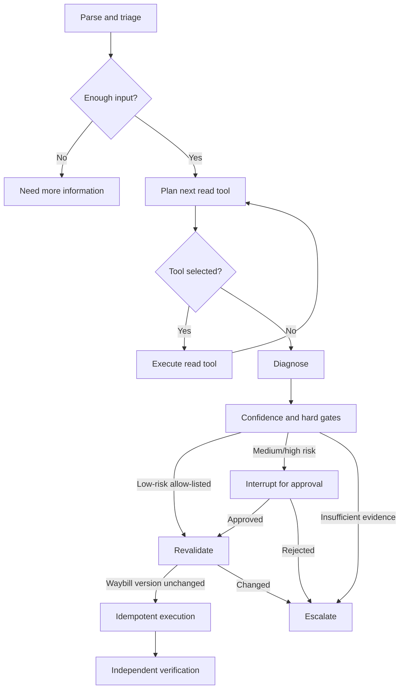

# Architecture and interview notes

## Why an agent is used

The workflow intentionally separates uncertain reasoning from deterministic control:

| Concern | Owner |
|---|---|
| Understand an ambiguous dispatch-operations message | Reasoner |
| Decide what evidence to query next | Reasoner |
| Propose a diagnosis and Playbook | Reasoner |
| Calculate executable confidence | Deterministic policy |
| Authorize production writes | Policy + human |
| Execute, deduplicate, and verify | Deterministic Tool service |

This answers the common interview question: "Why not use a normal state machine?" The state
machine still owns safety and execution; the Reasoner handles ambiguity and open-ended evidence
collection.

## Workflow



## Confidence

The final score is intentionally not the LLM's self-reported confidence:

```text
0.20 * intent
+ 0.25 * evidence completeness
+ 0.20 * evidence consistency
+ 0.15 * historical match
+ 0.20 * Playbook success rate
```

Hard gates run before execution. Missing required evidence or a non-allow-listed Playbook always
blocks execution regardless of the score.

## Trust boundaries

- User messages, logs, and Tool output are untrusted data.
- The model receives read-only Tool choices only.
- The execution service accepts a Playbook ID, never arbitrary SQL.
- Every execution is bound to one case, one waybill, one expected version, and one idempotency key.
- Approval is not authorization in a real deployment; authentication and RBAC must be enforced by
  the API and Tool service. This demo records the approver but does not implement enterprise SSO.

## Persistence

Two logical types of persistence share the demo SQLite file:

1. LangGraph checkpoint tables restore graph execution and pending interrupts.
2. Business tables support Case lookup, approval audit, timelines, idempotency, and demo Tool data.

They should remain conceptually separate. In production, use PostgreSQL and apply retention,
encryption, RBAC, and PII redaction policies.

The default HTTP path now adds a third persistence concern: `repair_jobs` owns a bounded
durable queue with atomic claims, owner tokens, heartbeats, write intents and stale-task
recovery. Approval interrupts release worker capacity. Tasks that may have submitted a write
can only query the original idempotency record and verify; recovery never resends the repair.
Each worker owns its checkpoint/HTTP/database connections and uses task budgets and shared
per-dependency concurrency limits/circuit breakers. Large evidence is archived, and terminal
task/checkpoint retention runs periodically. See [the Chinese stability guide](稳定性与长期运行.md)
for configuration, endpoints and the limits of cooperative cancellation.

## Production gaps

- Replace demo identity fields with verified SSO/RBAC claims.
- Replace SQLite with PostgreSQL and configure connection pooling.
- Put repair execution behind a separately deployed least-privilege service.
- Store large snapshots in object storage and keep hashes/references in the audit DB.
- Add OpenTelemetry traces, model/token cost metrics, and alerting.
- Build a labeled evaluation set and calibrate thresholds per Playbook.
- Add rate limits, approval expiry, distributed waybill locks, and compensating actions.

## Backend repair API boundary

The Agent execution tool now calls a fixed HTTP endpoint selected by Playbook ID.
`backend_client.py` owns the request contract, timeout handling and response validation.
`mock_backend.py` owns demo business transactions and idempotency; its SQL is an internal
backend implementation, not an Agent-generated repair command. Core evidence reads
also use the backend so revalidation and verification see the same business data.
The default transport is a local HTTP mock. `backend_api.py` exposes the same contract
as an independently runnable FastAPI server. Ambiguous write outcomes produce
`EXECUTION_OUTCOME_UNKNOWN` and are not automatically retried or redirected to local writes.
