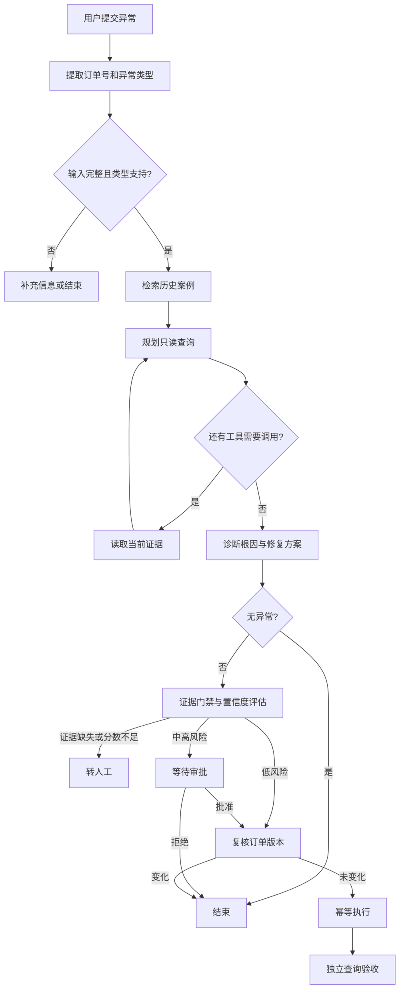

# 异常数据修复 Agent：使用与代码导读

## 项目解决什么问题

本项目演示派送业务中的数据不一致诊断与修复。用户提交异常描述后，系统读取当前订单、派送任务、作业事件和看板，参考历史案例，选择允许执行的修复方案。

目前是本地演示系统：业务数据存储在 SQLite，支持三类异常。默认使用规则推理，可配置真实 LLM。用户描述是待核实的陈述，历史案例是参考，当前查询结果才是诊断证据。

## 从哪里启动

在终端执行：

```bash
cd /Users/jaden/找工作/repair-agent
source .venv/bin/activate
```

若尚未安装依赖，先执行 `pip install -e .`。

### HTTP 服务入口

```bash
repair-agent-api
```

打开 <http://127.0.0.1:8000/docs>。在 `POST /cases` 中输入：

```json
{
  "message": "订单 W1001 线下已签收，但系统还是派送中",
  "requester_id": "demo-user"
}
```

提交会立即返回 `QUEUED`。通过 `GET /cases/{case_id}` 等待状态进入 `WAITING_APPROVAL`，再调用 `POST /cases/{case_id}/approval`：

```json
{
  "actor_id": "developer",
  "approved": true,
  "comment": "已核实签收证据，批准修复"
}
```

审批返回 `APPROVAL_QUEUED`，后台完成执行并通过验收后预期为 `SUCCEEDED`；重复演示时可通过 `POST /demo/reset` 重置业务数据。

### 命令行入口

```bash
# 重置演示数据并批准签收修复
repair-agent --reset-demo --approve "订单 W1001 已签收，但系统仍在派送中"

# 作业事件不可用：转人工，不修复
repair-agent --reset-demo "订单 W1002 已签收，但系统仍在派送中"

# 看板过期：低风险自动执行
repair-agent --reset-demo "订单 W3001 已送达，但派送看板显示还在派送中"
```

`--approve` 是演示用自动提交审批结论；未指定批准或拒绝时，CLI 会对待审批工单交互询问。

## 一次请求如何执行



调查最多九轮，工具仅允许只读查询。修复只能使用已注册的 Playbook，不允许模型生成任意 SQL。

## 代码阅读顺序

| 文件 | 重点函数 | 职责 |
|---|---|---|
| `repair_agent/api/app.py` | `create_app()`、`run()` | HTTP 路由与服务启动 |
| `repair_agent/cli.py` | `main()`、`summary()` | 命令行参数、审批交互与结果展示 |
| `repair_agent/application/runtime.py` | `create_case()`、`decide_approval()` | 协调工单持久化、图执行和审批恢复 |
| `repair_agent/agent/graph.py` | `build_graph()` 内的节点与路由函数 | 编排检索、调查、诊断、门禁、审批、执行和验收 |
| `repair_agent/agent/reasoning.py` | `triage()`、`plan_next_tool()`、`diagnose()` | 规则或 LLM 推理；模型结果经过结构和白名单校验 |
| `repair_agent/knowledge/store.py` | `import_file()`、`search()` | 历史案例导入、中文 BM25 检索和来源追踪 |
| `repair_agent/tools/service.py` | `call_read_tool()`、`execute_playbook()`、`verify()` | 读取事实、受控修复和独立验收 |
| `repair_agent/persistence/repository.py` | `save_case_state()`、`add_event()`、`add_approval()` | 业务、工单及审计数据库操作 |
| `repair_agent/domain/playbooks.py` | `get_playbook()` | 白名单方案、风险等级和自动执行策略 |
| `repair_agent/agent/models.py` | `RepairState` 等类型 | 节点共享状态、输入输出与验证模型 |
| `repair_agent/domain/models.py`、`repair_agent/domain/statuses.py` | `Evidence`、`OrderStatus`、`DeliveryTaskStatus` | 共用事实类型与业务状态 |
| `repair_agent/api/schemas.py` | `CreateCaseRequest`、`ApprovalRequest`、`CaseResponse` | HTTP 请求与响应结构 |

`agent/graph.py` 的节点返回需要更新的状态字段，而不是重建整个状态。路由函数返回下一节点名称。审批用 `interrupt()` 暂停，由 `Command(resume=...)` 恢复；同一工单使用同一 `thread_id`。

## RAG 如何使用

导入格式见 `examples/historical_cases.json`，它是合成示例，不会自动入库。字段含义如下：

| 字段 | 含义 |
|---|---|
| `case_id` | 唯一案例编号；重复导入更新同一案例 |
| `title`、`description` | 案例标题与异常表现 |
| `issue_type` | 当前支持的异常类型或 UNKNOWN |
| `root_cause` | 已确认的历史原因 |
| `repair_steps` | 历史修复步骤 |
| `prerequisites` | 修复适用条件 |
| `verification` | 验收标准或结果 |
| `playbook_id` | 白名单方案 ID；无法自动处理时允许 null |
| `source` | 来源，用于追踪参考依据 |

```bash
python -m repair_agent.knowledge examples/historical_cases.json
# 将下列路径替换成自己的真实数据文件
python -m repair_agent.knowledge /absolute/path/history.jsonl
```

默认业务库为 `data/repair_agent.db`，默认知识库为 `data/repair_agent.db.knowledge.db`。修改业务库时，知识库默认随业务库路径追加 `.knowledge.db`。也可通过 `REPAIR_KNOWLEDGE_DB` 指定知识库，导入时应使用 `--db` 指向同一文件。

检索过程：按异常类型过滤 → 对标题、描述和根因分词 → BM25 排序 → 返回最多三条案例。英文数字词保留整体，中文按双字片段切分；修复步骤会随命中案例返回，但当前不作为检索打分字段。

使用 `GET /knowledge/search?query=签收` 预览。Case 中的 `knowledge_hits` 保存案例内容、分数与内容哈希，`audit` 保存检索节点记录。

真实 LLM 在诊断阶段接收历史引用。默认 RuleReasoner 仍按当前证据执行规则诊断，历史引用只展示和审计。当前没有向量检索、重排器或基于真实历史结果校准的置信度；BM25 分数不能当作修复正确率。

## 如何启用真实模型

在项目根目录的 `.env` 填写三个配置，然后启动服务，程序自动读取：

```dotenv
REPAIR_LLM_BASE_URL=https://your-provider.example/v1
REPAIR_LLM_API_KEY=你的密钥
REPAIR_LLM_MODEL=你的模型名称
```

本地模板为 `.env.example`，真实 `.env` 被 Git 忽略。配置文件位置、优先级和重启生效规则见 [本地配置文件](本地配置文件.md)。

端点需兼容 Chat Completions：问题提取与诊断使用 JSON Schema，只读工具规划使用原生 `tools` / `tool_calls`，工具结果以 `role: tool` 回传。请求、解析或校验失败时回退本地规则。LLM 负责理解、规划和诊断，门禁、审批、写操作和验收由确定性代码控制。

## 如何理解结果

- `knowledge_hits`：历史参考，不是当前事实。
- `evidence`：当前业务查询结果，包含 FOUND、NOT_FOUND、UNAVAILABLE 等状态。
- `missing_evidence`：缺少哪些必需事实。
- `confidence_breakdown`：五个维度及最终加权分数。
- `decision`：自动执行、待审批、拒绝或需补充信息。
- `execution_result`：工具执行结果。
- `verification_result`：独立业务验收结果，不能用工具执行成功替代。
- `audit`：逐节点的简要执行记录；业务事件另可通过 timeline 接口查看。

目前置信度包含规则常量、模型输出及 Playbook 示例成功率，并不是经真实数据校准的概率。历史 RAG 分数未直接加入置信度。缺失关键证据和无白名单方案会优先阻止修复；符合分数要求的低风险方案自动执行，中高风险等待审批。

## 测试与边界

```bash
python -m unittest discover -s tests -v
```

测试覆盖审批、缺证据拒绝、误报、幂等、重启恢复、版本变化及历史检索。测试通过不能替代真实业务评测。

当前 API 记录请求者和审批者字符串，尚未实现真实身份认证和 RBAC；知识库也未实现租户隔离。当前版本适合本地学习与演示，接入真实数据前需要按业务实现权限校验。示例中的重置与版本变更接口属于演示工具。

## 五个平台模拟工具

当前 Agent 在原有核心只读查询之后调查五个平台，调查上限已提升为九轮。规则推理依旧依据核心业务证据选择修复方案；真实 LLM 可参考平台证据判断原因。所有平台工具都是本地模拟，不会连接线上系统。

| 工具名 | 模拟内容 |
|---|---|
| `QUERY_LOG_PLATFORM` | 服务名、trace ID、错误日志；W1002 模拟平台不可用 |
| `QUERY_ONLINE_DATA` | 当前演示库的订单和任务；修复后可读到最新状态 |
| `QUERY_CONFIG_CENTER` | 命名空间、配置版本、同步开关与重试次数 |
| `QUERY_SCHEDULER` | cron、最近执行结果与下次执行时间；W3001 模拟任务超时 |
| `QUERY_HIVE_TABLE` | 固定表与分区中的历史状态快照，明确标注离线时效 |

`GET /tools/platforms` 查看工具目录。单独调用示例：

```bash
curl 'http://127.0.0.1:8000/tools/platforms/QUERY_LOG_PLATFORM?order_id=W1001'
curl 'http://127.0.0.1:8000/tools/platforms/QUERY_ONLINE_DATA?order_id=W1001'
curl 'http://127.0.0.1:8000/tools/platforms/QUERY_CONFIG_CENTER?order_id=W1001'
curl 'http://127.0.0.1:8000/tools/platforms/QUERY_SCHEDULER?order_id=W3001'
curl 'http://127.0.0.1:8000/tools/platforms/QUERY_HIVE_TABLE?order_id=W1001'
```

平台实现位于 `repair_agent/tools/platforms.py`。日志、配置、任务和 Hive 的固定模拟记录位于 `repair_agent/tools/fixtures/platforms.json`，修改后重启服务生效。线上数据来自业务演示库；`/demo/reset` 会重置业务库，但不重新加载平台文件。模拟时间与分区是固定演示值，不表示当前平台状态。

工具返回统一 Evidence：`evidence_id`、`source`、`fact_type`、`value`、`status`、`authoritative`。平台可用但无对应记录返回 NOT_FOUND，平台故障返回 UNAVAILABLE。Hive、日志和配置等不充当订单当前权威状态，不能绕过事件缺失、审批与版本校验。Hive 工具只模拟固定表按订单过滤的查询，不执行任意 SQL。

## 修复执行：调用封装后端接口

Agent 不直接更新业务表。执行节点选择白名单 Playbook，再由 `tools/backend_client.py` 调用固定后端接口：

| Playbook | HTTP 接口 |
|---|---|
| APPLY_DELIVERY_COMPLETION_V1 | POST /repairs/delivery-completion |
| APPLY_PICKUP_SCAN_V1 | POST /repairs/pickup-scan |
| REBUILD_DISPATCH_PROJECTION_V1 | POST /repairs/dispatch-projection |

请求包含 `case_id`、`order_id`、`expected_version`、`idempotency_key`，并在 `Idempotency-Key` 请求头重复携带幂等键。接口地址由白名单映射，不允许模型生成 SQL、URL 或任意更新字段。后端返回业务成功标记、原因和新版本；Agent 随后通过只读接口独立验收。

默认离线模式使用 HTTP MockTransport 模拟调用，`demo/backend.py` 在业务后端边界内执行演示库事务。SQLite SQL 是模拟后端的数据实现，不是 Agent 发出的修数指令。工单与审计数据库仍由 Agent 本地保存。

可运行独立模拟后端验证真实 HTTP 链路：

```bash
# 终端一，启动封装业务后端
source .venv/bin/activate
uvicorn repair_agent.demo.api:create_backend_app --factory --host 127.0.0.1 --port 8001

# 终端二，配置 Agent 调用后端
source .venv/bin/activate
export REPAIR_BACKEND_BASE_URL="http://127.0.0.1:8001"
repair-agent-api
```

独立模拟后端默认业务库为 `data/repair_backend.db`，用 `REPAIR_BACKEND_DB` 修改。外部模式下核心业务读取、执行前版本检查、线上数据查询及验收都走该后端的 `/evidence/{tool}` 接口。日志、配置、任务和 Hive 仍是本地固定模拟数据。Agent 的 `/demo/reset` 和版本变更演示接口只操作本地库，不会重置或改动独立后端；独立后端初次运行会插入演示数据。

生产后端需实现同一契约，或按现有接口调整客户端。可通过 `REPAIR_BACKEND_API_KEY` 发送 Bearer 凭据；模拟服务器未实现认证，不代表生产权限已经接入。

超时、HTTP 错误和不可解析的响应不触发本地 SQL 回退或自动重试。写入结果不明确时，工单进入 `EXECUTION_OUTCOME_UNKNOWN`，需要核实后端执行记录与当前状态再处置；客户端不能仅凭超时断言后端未修改数据。

## 长期运行

任务队列、Worker、预算、取消、对账、停机、数据清理和运行指标见 [稳定性与长期运行](稳定性与长期运行.md)。
